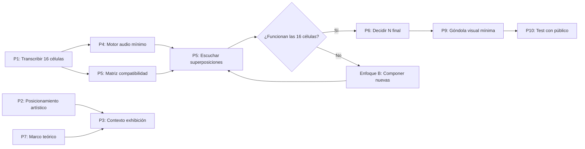

# Comité de Expertos — Revisión Crítica de IN M

**Documento analizado:** [IN_M_analisis_completo.md](file:///Users/vladimirobellini/Documents/REPOS/inmsynth/doc/IN_M_analisis_completo.md)  
**Fecha:** 24 de octubre de 2026  
**Formato:** 3 especialistas · 5 iteraciones de deliberación · Conclusiones finales

---

## Panel de Expertos

| Experto | Perfil | Enfoque |
|---|---|---|
| **Dra. Elena Vargas** | Sistemas Interactivos, HCI, Web Audio API | Arquitectura técnica, usabilidad, rendimiento, accesibilidad |
| **Dr. Martín Ríos** | Composición, teoría musical, minimalismo | Armonía, contrapunto, polirritmia, diseño generativo |
| **Dra. Lucía Montiel** | Arte contemporáneo, estudios culturales, semiótica | Apropiación artística, cultura popular, recepción, contexto de exhibición |

---

## ITERACIÓN 1 — Análisis Individual

### 🔵 Dra. Elena Vargas — Sistemas Interactivos y HCI

#### Fortalezas

1. **Separación correcta de motor de audio y visualización** (§8.3). El documento identifica con precisión que los eventos musicales deben planificarse desde el reloj del motor de audio, no desde `requestAnimationFrame`. Esta es una decisión arquitectónica fundamental que muchos proyectos similares ignoran, causando latencia e inestabilidad.

2. **Modelo de datos bien estructurado** (§8.1). La definición de `Obra → patrones[] → intérpretes[]` con estado independiente por intérprete es un modelo limpio que separa adecuadamente los datos de la presentación. Es extensible y facilita la serialización para guardar/compartir estados.

3. **Escalado progresivo de la complejidad** (§6.6, §10). La propuesta de cuatro modos de interacción (automático → manual → híbrido → colectivo) y seis etapas de desarrollo demuestra madurez en el pensamiento de diseño incremental. No se intenta todo a la vez.

4. **Referencia a Tone.js y Web Audio API** (§8). Apoyarse en la experiencia de Don Satur Synth con Tone.js es inteligente: reutilizar una pila tecnológica probada reduce riesgo. La mención explícita del patrón de planificación anticipada (lookahead scheduler) es correcta.

5. **Definición de estados visuales** (§6.4). Enumerar qué debe comunicar cada módulo visualmente (activo, cuántas voces, fase, identidad del intérprete) es un ejercicio de diseño de información infrecuente en documentos de este tipo. Demuestra rigor.

#### Debilidades y Omisiones

1. **Ausencia total de requisitos de rendimiento**. No se establece ningún objetivo de latencia (¿50ms? ¿100ms?), framerate visual mínimo, número máximo de nodos de audio simultáneos, ni presupuesto de CPU/memoria. Sin estos benchmarks, no hay criterio para evaluar si el prototipo funciona.

2. **Sin estrategia de compatibilidad cross-browser**. Web Audio API tiene diferencias significativas entre Chrome, Firefox y Safari (especialmente en iOS, donde `AudioContext` requiere interacción del usuario y tiene limitaciones de polifonía). El documento no aborda esto.

3. **Accesibilidad completamente ausente**. No hay mención de WCAG, navegación por teclado, lectores de pantalla, alternativas textuales para la información visual/sonora, ni consideraciones para usuarios con discapacidad auditiva o visual. Para una aplicación web pública, es una omisión grave.

4. **Sin arquitectura de estado reactiva**. El documento menciona "estado musical observable" (§8.2) pero no define cómo se propaga ese estado a la UI. ¿Observables? ¿Event bus? ¿Store centralizado? Sin esto, la sincronización audio-visual será frágil.

5. **Modo colectivo multiusuario sin especificar**. La §6.6 menciona un modo "colectivo" donde cada participante controla una voz, pero no hay ninguna discusión sobre comunicación en red: ¿WebSockets? ¿WebRTC? ¿Latencia de red aceptable? ¿Sincronización de reloj distribuido? Este es un problema técnico de primer orden que se despacha en una línea.

6. **Sin consideración de persistencia y compartición**. ¿Se puede guardar una ejecución? ¿Exportar audio? ¿Compartir un enlace a un estado particular? ¿Modo offline? Estas funcionalidades definen la utilidad real de la aplicación.

7. **Falta definición de la capa de sonido**. El §8.7 lista posibles capas (vocal, síntesis, instrumentos, pulso, procesamiento) pero no define la cadena de procesamiento de audio: ¿cuántos nodos por voz? ¿Efectos compartidos? ¿Bus de mezcla? ¿Compresión/limitación para evitar clipping con muchas voces simultáneas?

#### Errores e Inconsistencias Técnicas

- El §8.2 muestra un flujo `RELOJ → PLANIFICADOR → SÍNTESIS → MEZCLA → AUDIO` pero el diagrama omite un componente crítico: el **buffer de lookahead** que permite programar notas con anticipación. Sin este buffer explícito, la implementación puede caer en el error exacto que el §8.3 dice querer evitar.

- El §8.4 describe una "probabilidad de avance ajustable" pero no define distribución probabilística ni rango. Una distribución uniforme vs. una gaussiana producirían comportamientos radicalmente diferentes. Esto no es un detalle de implementación: es una decisión de diseño musical.

#### Propuestas Concretas

1. **Definir un Performance Budget**: máximo 8 voces simultáneas con síntesis FM simple, latencia < 50ms, 60fps visuales en hardware medio (MacBook Air 2020 o equivalente).

2. **Implementar un AudioGraph Manager**: componente que administre la creación/destrucción de nodos de audio, con pooling para evitar garbage collection durante la ejecución.

3. **Diseñar primero para teclado**: toda interacción debe ser operable sin mouse. Usar roles ARIA para la góndola (`role="grid"`) y los intérpretes (`role="listitem"` con `aria-current`).

4. **Prototipo de audio sin UI**: antes de construir la góndola visual, implementar un motor de audio puro que se pueda probar con `console.log` para validar la lógica de avance, superposición y proximidad.

5. **Definir formato de serialización**: JSON Schema para las células, YAML para configuración de interpretación, y un formato de exportación de sesión (incluyendo timestamps de cada evento).

6. **Agregar un monitor de rendimiento en desarrollo**: overlay que muestre voces activas, CPU del AudioContext, GC pauses y framerate visual.

---

### 🟢 Dr. Martín Ríos — Composición y Teoría Musical

#### Fortalezas

1. **Comprensión correcta del mecanismo de *In C*** (§2). El documento demuestra que el autor entiende que lo esencial de Riley no es la cifra 53 sino el procedimiento: secuencia compartida, repetición libre, avance individual y proximidad colectiva. Esto distingue al documento de muchos homenajes superficiales.

2. **La decisión de no forzar 53 patrones es musicalmente sólida** (§4). La autocrítica en la sección 4 —donde el comité revisa su propia posición y la corrige— es un gesto intelectualmente honesto y compositivamente acertado. El número de células debe surgir del material, no de una numerología.

3. **Tres niveles de fragmentación** (§5.1). Distinguir entre producto, microfrase y frase es útil. No toda la textura puede consistir en células atómicas: se necesitan unidades de diferentes escalas para generar arco formal.

4. **Conciencia de la modulación Re → Mi** (§1.3, §5.4). Identificar que la armonía del jingle implica un desplazamiento tonal es correcto y fértil. Este es probablemente el problema compositivo más interesante del proyecto: cómo gestionar una modulación en un contexto de repeticiones y superposiciones.

5. **Tres dramaturgias posibles de reconocimiento** (§5.6). Plantear "abstracto → reconocible", "reconocible → abstracto" y "oscilante" como arcos posibles muestra pensamiento formal, no solo técnico. La recomendación de la tercera opción es sensata para una obra de duración variable.

#### Debilidades y Omisiones

1. **No hay ni una sola nota escrita**. El documento habla extensamente de composición pero **no incluye ninguna transcripción melódica, ningún ejemplo sonoro, ningún intervalo concreto**. La tabla de productos (§1.2) solo cuenta sílabas. El esquema YAML (§5.3) deja las notas como `[]`. Esto es la debilidad fundamental: se analiza una composición que aún no existe.

2. **Análisis armónico insuficiente** (§1.3). La progresión `D G A | Bm G D A | D A G A | E B A B | E A B | C#m A B A E` se presenta sin ninguna explicación funcional. ¿Cuál es la función de cada acorde? ¿Es I-IV-V? ¿Hay dominantes secundarias? ¿El paso de D a E es una modulación real (cambio de tónica) o un desplazamiento modal? Sin este análisis, las decisiones sobre qué células son compatibles serán arbitrarias.

3. **Sin discusión de registro y espaciación vertical**. Cuando 4-8 voces suenan simultáneamente, el registro de cada una es crítico. Dos voces en la misma octava con la misma célula producen batido; con una octava de separación, contrapunto. El documento no aborda esto.

4. **Polirritmia mencionada pero no explorada** (§5.5). Se dice que "células de 2, 3, 4, 5 o 7 pulsos pueden producir múltiples fases" pero no se analiza ningún caso concreto. ¿Cuáles son las proporciones rítmicas del jingle original? ¿Son todas las células de la misma duración? Esto determina si el phasing producirá texturas interesantes o caos.

5. **Falta análisis del contorno melódico**. En *In C*, Riley diseñó los 53 patrones con cuidado para que las superposiciones produzcan armonías emergentes. Un patrón que oscila entre C y E suena consonante con uno que usa G y B. El documento no aborda qué intervalos melodicos produce el jingle y si son compatibles en superposición.

6. **No hay criterios de "buena superposición"**. ¿Qué hace que dos células suenen bien juntas? ¿Compartir notas? ¿Compartir ritmo? ¿Complementarse armónicamente? Sin criterios explícitos, el Experimento 1 (§9) no tiene marco evaluativo.

7. **Relación ambigua con la voz humana**. El documento oscila entre usar fragmentos vocales del jingle y síntesis pura, sin definir el papel de la voz. En *In C*, la instrumentación es libre pero el material es instrumental. Aquí el material es vocal-verbal: la presencia o ausencia de la voz humana cambia radicalmente la experiencia.

#### Errores e Inconsistencias

- **El §5.5 es contradictorio consigo mismo**: dice que las duraciones deben surgir de la prosodia del jingle, pero también que células de "5 o 7 pulsos" podrían ser interesantes. Si la prosodia del jingle es predominantemente binaria o ternaria (como sugiere la tabla de sílabas), las duraciones de 5 o 7 serían artificiales. Hay que elegir: ¿prosodia o aritmética?

- **La §5.2 distingue dos enfoques (reorganización vs. composición nueva) pero la §5.4 asume que se trabaja con la armonía original**. Si se elige el Enfoque B (composición nueva), la armonía podría ser distinta. El documento no resuelve esta dependencia.

- **La tabla de productos (§1.2) dice que "cacao" tiene "3 sílabas, según articulación"**, pero en la pronunciación rioplatense común es claramente trisílabo (ca-ca-o). La ambigüedad es innecesaria.

#### Propuestas Concretas

1. **Transcribir las 16 células antes que cualquier otra cosa**. Hacer un spectrograma del jingle, identificar las alturas exactas (no los acordes, sino la melodía), y producir una tabla con: nota, duración, dinámica y relación con el acorde subyacente.

2. **Crear una matriz de compatibilidad de pares**. Antes de implementar nada, componer en papel o DAW cada par de células vecinas (i, i+1) y (i, i+2), evaluar la consonancia/disonancia resultante y documentar el resultado.

3. **Definir explícitamente la relación de registros entre intérpretes**. Propongo: Voz 1 = octava original, Voz 2 = octava superior, Voz 3 = octava inferior, Voz 4 = quinta, etc. Con reglas de octavación claras.

4. **Hacer un estudio de phasing con duraciones reales del jingle**. Si "mate" dura 1 tiempo y "mermelada" dura 2 tiempos, ¿cuándo se realinean? Graficar las coincidencias. Esto es lo que hace interesante a *In C* y lo que hará o deshará a *IN M*.

5. **Componer al menos 3 "células puente"** para la transición Re → Mi. Estas son las que permitirán que la modulación no suene como un accidente sino como una evolución.

6. **Definir un "modo de prueba" compositivo**: 4 voces, solo síntesis simple, sin visuales. Probar las 16 células puras y documentar qué combinaciones funcionan y cuáles no, antes de agregar nada.

---

### 🔴 Dra. Lucía Montiel — Arte Conceptual y Estudios Culturales

#### Fortalezas

1. **El desplazamiento funcional es la operación más poderosa del proyecto** (§0). La idea de que la repetición publicitaria y la repetición minimalista comparten mecanismos pero con fines opuestos no es un chiste ni una curiosidad: es una tesis artística genuina. Marolio usa la repetición para fijar una marca; Riley la usa para transformar la percepción. *IN M* desplaza una hacia la otra. Esto puede generar una experiencia de escucha profundamente perturbadora y reveladora.

2. **La advertencia contra el exceso de gamificación** (§3, Ronda 4, Conclusión 4) es crucial. La tentación de convertir la góndola en un juego de supermercado es enorme y destruiría la potencia conceptual. La interfaz debe ser partitura, no videojuego.

3. **La autocorrección sobre los 53 patrones** (§4) demuestra capacidad de pensamiento crítico. El documento no se enamora de su primera idea; la revisa, la cuestiona y la modifica. Esto es raro y valioso en documentos de proyecto artístico.

4. **La declaración artística final** (§12) es concisa y elocuente. Resume bien el proyecto sin sobreexplicar. Es usable para textos curatoriales, convocatorias y comunicación.

5. **La triple categoría obra/instalación/instrumento** (Ronda 6) es una pregunta correcta. No es lo mismo una pieza de 20 minutos con final que una instalación continua que una herramienta compositiva. Definirlo cambia todo: el contexto de exhibición, la duración, la relación con el público.

#### Debilidades y Omisiones

1. **Ausencia de marco teórico sobre apropiación**. El documento opera una apropiación artística de un material comercial (un jingle publicitario) pero no sitúa esta operación en ninguna tradición artística. No menciona a Warhol, Duchamp, el detournement situacionista, el culture jamming, el arte pop, ni ninguna referencia de arte y publicidad. Esto debilita la fundamentación conceptual y deja al proyecto vulnerable a la lectura superficial de "es un chiste con Marolio".

2. **Sin reflexión sobre el contexto de clase**. Marolio no es cualquier marca: es una marca de consumo masivo asociada específicamente a las clases populares argentinas. Tomar este material tiene implicaciones de clase que el documento ignora completamente. ¿Es homenaje? ¿Es ironía? ¿Es condescendencia? ¿Es celebración? El proyecto necesita posicionarse explícitamente.

3. **La dimensión sonora de la publicidad como fenómeno cultural no se explora**. El jingle de Marolio es un hito de la cultura sonora argentina: prácticamente todo el país puede cantarlo. Este fenómeno —un objeto sonoro involuntariamente memorizado por millones— es en sí mismo un tema artístico fascinante que el documento apenas roza. ¿Qué significa que una melodía sea propiedad cultural compartida pero jurídicamente privada?

4. **Sin discusión de contextos de exhibición concretos**. ¿Dónde se mostraría *IN M*? ¿Galería? ¿Centro cultural? ¿Festival? ¿Web pública? ¿Instalación permanente? ¿Performance en vivo? Cada contexto modifica radicalmente la recepción. Un cubo blanco con altavoces es una experiencia; una pestaña de navegador es otra.

5. **El documento no aborda la relación con la marca**. Más allá de la nota de derechos (§11), no hay reflexión sobre qué pasa si Marolio se entera: ¿puede capitalizar el proyecto? ¿Puede vetarlo? ¿Qué pasa si el proyecto se vuelve viral y la marca lo adopta como publicidad? Estas preguntas no son legales: son conceptuales.

6. **Falta la voz del público**. En todo el documento, el espectador/oyente/usuario es una abstracción. No hay ningún perfil de audiencia, ningún escenario de recepción, ningún test de concepto con personas reales. El Experimento 3 (§9) propone uno, pero debería haberse hecho antes de escribir 669 líneas.

7. **Referencia a POSNETES sin contexto suficiente**. El documento menciona el ecosistema POSNETES, Don Satur Synth, Dibusynth y Rollito como antecedentes, pero no explica qué lecciones concretas se aprendieron de ellos ni cómo influyeron en las decisiones de *IN M*.

#### Errores e Inconsistencias

- **La sección §7 presenta puntuaciones numéricas (5/5, 4/5, etc.) sin criterios de evaluación definidos**. ¿Qué significa "Rigor musical 5/5"? ¿Comparado con qué? ¿Medido cómo? Estas cifras crean una falsa apariencia de objetividad. Es más honesto decir "la propuesta B es la más equilibrada" sin inventar una escala.

- **El documento dice que es un "comité simulado" (§3) pero luego trata las conclusiones como si fueran resultado de un debate real**. La transparencia metodológica es correcta, pero las conclusiones no deberían tener más peso que el pensamiento de un solo autor que considera múltiples perspectivas. La forma de "comité" puede inflacionar artificialmente la autoridad del texto.

#### Propuestas Concretas

1. **Incluir un breve marco de referencia artístico**: mínimo 10 líneas que sitúen el proyecto en relación con el Pop Art (Warhol, Lichtenstein), el détournement situacionista (Debord), la plunderphonics (John Oswald), el culture jamming (Negativland) y el arte sonoro argentino (Virus, Marta Minujín, Reynols).

2. **Definir un posicionamiento ético-político explícito frente al material**. ¿El proyecto celebra a Marolio? ¿Lo critica? ¿Lo neutraliza? ¿Lo transforma? Una línea del tipo: "IN M no se burla de Marolio ni lo promociona: toma su material sonoro como una materia prima cultural compartida y lo somete a un proceso de escucha atenta que revela lo que la repetición publicitaria esconde."

3. **Diseñar al menos 2 escenarios de exhibición concretos** con especificaciones: (a) Instalación en galería: pantalla, altavoces, duración, comportamiento sin público. (b) Web pública: URL, requisitos de navegador, onboarding, experiencia de 2 minutos vs. 20 minutos.

4. **Realizar un test de concepto con 5 personas** antes de seguir desarrollando. Mostrar el boceto (§6.3) y explicar el concepto en 2 minutos. Preguntar: ¿qué entendiste? ¿qué sentiste? ¿por qué seguirías escuchando o no?

5. **Documentar explícitamente las lecciones de los proyectos previos** (Don Satur Synth, Dibusynth, Rollito). ¿Qué funcionó? ¿Qué falló? ¿Qué se reutiliza y qué se cambia?

---

## ITERACIÓN 2 — Respuesta Cruzada

### Vargas responde a Ríos

> **Coincidencia fuerte**: la necesidad de tener notas reales antes de construir nada. Sin las 16 células transcritas, toda la arquitectura que yo propongo opera sobre datos ficticios. El "motor de audio sin UI" que yo pido es exactamente el "modo de prueba compositivo" que Ríos propone.

> **Discrepancia**: Ríos propone reglas de octavación fijas por intérprete (Voz 1 = octava original, Voz 2 = octava superior…). Yo diría que esto debería ser un **parámetro configurable**, no una regla fija, para permitir exploración. Hardcodear registros es un error de diseño de sistema.

> **Punto que le falta**: Ríos no aborda la **complejidad computacional** de las superposiciones. Con 8 voces y 16 células, hay combinaciones enormes. ¿Cuántos nodos de audio simultáneos? ¿Qué pasa con el consumo de CPU si cada voz tiene su propia cadena de efectos? La composición debe considerar las limitaciones del medio.

### Vargas responde a Montiel

> **Coincidencia fuerte**: la ausencia de contextos de exhibición concretos afecta directamente al diseño técnico. Una instalación con 5.1 surround en una galería vs. una página web en auriculares son productos técnicos completamente diferentes. Necesito esta decisión para dimensionar la arquitectura.

> **Aporte valioso que yo no consideré**: la cuestión de clase. No es un problema técnico, pero sí un problema de **diseño de experiencia**. Si el público objetivo incluye personas que no tienen acceso a hardware potente, debo optimizar para dispositivos móviles y conexiones lentas. El diseño inclusivo no es solo accesibilidad WCAG: es accesibilidad socioeconómica.

### Ríos responde a Vargas

> **Coincidencia**: un motor de audio funcional sin interfaz gráfica es la única forma de validar las decisiones compositivas antes de invertir semanas en visuales. Si las 16 células no suenan bien superpuestas, ninguna góndola bonita lo va a arreglar.

> **Discrepancia**: Vargas habla de "Performance Budget" con un máximo de 8 voces. Yo diría que el número de voces es una decisión **compositiva**, no técnica. Si la obra necesita 12 voces para funcionar, el técnico debe encontrar la manera. El arte no se limita al benchmark; el benchmark se adapta al arte. Entiendo las limitaciones del navegador, pero poner el techo antes de componer me parece poner el carro delante del caballo.

> **Punto que le falta**: Vargas habla de serialización y JSON Schema pero no de **formatos musicales estándares**. ¿Por qué no MusicXML o MIDI para las células? Esto permitiría importar/exportar desde DAWs y facilitaría la colaboración con músicos que no programan.

### Ríos responde a Montiel

> **Coincidencia fuerte**: la necesidad de posicionamiento frente al material. Una obra musical que no sabe si celebra o critica su fuente produce ambigüedad improductiva, no tensión fértil. La plunderphonics de Oswald tiene una posición clara; el détournement situacionista también. IN M necesita la suya.

> **Aporte que no consideré**: el fenómeno de la melodía como "propiedad cultural compartida pero jurídicamente privada" es efectivamente un tema artístico poderoso. Compositivamente, esto sugiere que la obra podría jugar deliberadamente con el **umbral de reconocimiento**: ¿en qué punto una célula deja de sonar a "Marolio" y empieza a ser música autónoma? Este es un efecto que se puede componer.

### Montiel responde a Vargas

> **Coincidencia**: sin definir el contexto de exhibición, el diseño técnico queda en el aire. Pero voy más lejos: el contexto de exhibición no es solo un dato técnico, es una **decisión artística** que modifica el significado de la obra. IN M en una galería de arte contemporáneo dice una cosa; en el celular de alguien en el colectivo dice otra. Ambas son válidas, pero son obras distintas.

> **Discrepancia parcial**: Vargas propone accesibilidad WCAG como requisito. Es correcto, pero la accesibilidad en el arte interactivo tiene una dimensión más compleja que en una aplicación utilitaria. ¿Tiene sentido una versión "solo texto" de una experiencia audiovisual generativa? ¿O es más honesto decir que la obra requiere visión y audición, y ofrecer una documentación en video para quienes no puedan experimentarla directamente?

### Montiel responde a Ríos

> **Coincidencia fuerte**: las tres dramaturgias del reconocimiento (§5.6) son la clave conceptual del proyecto. Compositivamente y conceptualmente, el momento en que el oyente dice "ah, eso es Marolio" es el momento artístico central. Todo debe diseñarse alrededor de ese umbral.

> **Discrepancia**: Ríos propone una "matriz de compatibilidad de pares" como herramienta puramente musical. Yo agregaría que la compatibilidad también tiene una dimensión **semántica**: "mate + café" evoca desayuno; "sardinas + atún" evoca conservas marinas. Estas asociaciones culturales producen sentido que la composición debe considerar o al menos ser consciente de que activa.

---

## ITERACIÓN 3 — Propuestas Integradas

Tras el cruce de perspectivas, el comité formula las siguientes propuestas integradas, ordenadas por urgencia:

### 🔴 Urgentes (antes de cualquier código)

**P1. Transcripción melódica verificada.** Ríos insiste, Vargas confirma, Montiel no se opone. Sin las notas reales, todo lo demás es especulación.
- **Acción**: transcribir nota por nota las 16 células del jingle usando la grabación de referencia.
- **Producto**: tabla con nota, duración, octava, dinámica, texto, acorde subyacente.

**P2. Posicionamiento artístico explícito.** Montiel lo exige, Ríos lo apoya, Vargas lo ve como input para el diseño de experiencia.
- **Acción**: escribir un texto de 200-300 palabras que declare la posición del proyecto frente a Marolio, la cultura popular y la apropiación artística.
- **Producto**: sección nueva en el documento, ubicable antes de las decisiones compositivas.

**P3. Definir el contexto de exhibición primario.** Montiel y Vargas coinciden en que esto determina todo lo demás.
- **Acción**: elegir entre (a) web pública, (b) instalación, (c) ambas como versiones distintas.
- **Producto**: brief técnico-artístico de 1 página por versión.

### 🟡 Necesarias (antes del prototipo funcional)

**P4. Motor de audio sin UI ("modo prueba compositivo").** Los tres coinciden.
- **Acción**: implementar las 16 células con 4 voces en Tone.js, sin interfaz gráfica.
- **Producto**: archivo HTML minimal con controles de texto que permita escuchar combinaciones.

**P5. Matriz de compatibilidad de superposiciones.** Ríos lo propone, Montiel agrega la dimensión semántica.
- **Acción**: probar cada par (i, i+1) y (i, i+2) de células. Documentar consonancia, disonancia, asociaciones culturales.
- **Producto**: tabla 16×16 con evaluación triple (armónica, rítmica, semántica).

**P6. Marco teórico mínimo.** Montiel lo exige.
- **Acción**: agregar al documento referencias concretas a tradiciones artísticas relevantes.
- **Producto**: 500 palabras con al menos 5 referencias (Warhol, Oswald, détournement, plunderphonics, arte sonoro argentino).

### 🟢 Importantes (para el prototipo completo)

**P7. Definición de registros y timbres por voz.** Ríos propone, Vargas recomienda que sea configurable.
- **Compromiso**: definir registros por defecto (sugeridos por Ríos) que sean modificables en la configuración (pedido por Vargas).

**P8. Estudio de phasing con duraciones reales.** Ríos propone.
- **Acción**: graficar las coincidencias de fase entre las duraciones reales de las 16 células.
- **Producto**: diagrama de Gantt o tabla de coincidencias.

**P9. Performance Budget técnico.** Vargas propone, Ríos acepta con reserva.
- **Compromiso**: definir un mínimo garantizado (4 voces, síntesis simple) y un máximo deseable (8-12 voces, muestras vocales). Si la composición necesita más, se busca la solución técnica.

**P10. Test de concepto con público.** Montiel propone.
- **Acción**: cuando exista el motor de audio básico (P4), mostrar a 5 personas y documentar reacciones.

---

## ITERACIÓN 4 — Evaluación de Viabilidad

### Viabilidad técnica (Vargas)

| Propuesta | Complejidad | Riesgo | Dependencias |
|---|---|---|---|
| P1. Transcripción | Baja (trabajo manual) | Bajo | Acceso a la grabación |
| P4. Motor sin UI | Media (2-3 días) | Bajo | P1 completada |
| P9. Performance Budget | Baja (benchmarks) | Bajo | P4 completada |
| P7. Registros configurables | Media | Bajo | P4 completada |
| Modo colectivo (multi-user) | **Alta** (WebSockets, sync) | **Alto** | Todo lo anterior + servidor |

**Veredicto técnico**: Las propuestas P1-P5 son factibles para un primer prototipo. El modo colectivo multiusuario debería dejarse para una versión 2.0.

**Riesgo técnico principal**: la superposición de múltiples muestras vocales puede generar problemas de latencia y clipping en dispositivos móviles. Recomiendo empezar con síntesis pura y agregar muestras vocales gradualmente.

### Viabilidad compositiva (Ríos)

| Propuesta | Factibilidad musical | Riesgo |
|---|---|---|
| P1. Transcripción | 100% factible | Si la grabación es de baja calidad, la transcripción será imprecisa |
| P5. Matriz de compatibilidad | Factible pero laboriosa (120 pares) | Puede producir parálisis analítica |
| P8. Estudio de phasing | Factible si P1 está hecha | Resultados pueden ser desalentadores (si todo es binario, poco phasing) |
| Composición de células puente | Requiere creatividad | Riesgo de que suenen artificiales |

**Veredicto compositivo**: La viabilidad musical depende enteramente de P1. Si la melodía del jingle es demasiado simple (todas las notas en la misma octava, mismo ritmo), la superposición será aburrida y habrá que pasar al Enfoque B (composición nueva a partir del jingle). **No hay que tener miedo de componer material nuevo**: Riley no tenía una canción preexistente, la compuso.

**Riesgo musical principal**: que las 16 células sean demasiado similares entre sí porque el jingle original las canta con la misma melodía transponiendo solo la armonía. Si todas las células son variantes de la misma línea melódica, la superposición producirá una masa homogénea sin evolución. Hay que estar preparados para el Enfoque B.

### Viabilidad conceptual (Montiel)

| Propuesta | Viabilidad cultural | Riesgo |
|---|---|---|
| P2. Posicionamiento | 100% factible, solo requiere escritura | Riesgo de sobreexplicar o moralizar |
| P3. Contexto de exhibición | Factible, requiere decisión | Intentar ambas versiones simultáneamente puede dispersar esfuerzos |
| P6. Marco teórico | Factible con investigación mínima | Riesgo de que suene académico y pierda la frescura del proyecto |
| P10. Test de concepto | Factible pero requiere prototipo mínimo | 5 personas no es estadísticamente significativo, pero sí útil como exploración cualitativa |

**Veredicto conceptual**: El proyecto tiene la densidad suficiente para funcionar como obra de arte sonoro contemporáneo. El mayor riesgo conceptual no es la falta de marco teórico sino la **complacencia**: que el equipo se conforme con el chiste del título ("In M, ja ja") y no empuje la experiencia auditiva hasta donde puede llegar. La obra debe funcionar **con los ojos cerrados** antes de que la góndola agregue valor.

---

## ITERACIÓN 5 — Conclusiones y Recomendaciones Finales

### A. Evaluación General del Documento

El documento [IN_M_analisis_completo.md](file:///Users/vladimirobellini/Documents/REPOS/inmsynth/doc/IN_M_analisis_completo.md) es un **documento de exploración conceptual de calidad notable**. Sus 669 líneas demuestran pensamiento riguroso, autocrítica (especialmente la revisión sobre los 53 patrones) y una comprensión genuina tanto del procedimiento de Riley como de las posibilidades del material de Marolio.

Sin embargo, el comité identifica una **asimetría estructural**: el documento es fuerte en conceptualización y planificación, pero débil en materialización. No contiene ni una sola nota musical, ni un pixel de interfaz, ni un test con público. Esto es comprensible para un "documento de exploración", pero el riesgo es que la exploración se vuelva infinita sin producir nunca una obra.

> [!IMPORTANT]
> **La recomendación central del comité es: pasar a hacer.** El documento tiene suficiente claridad conceptual para comenzar a componer y prototipar. Cada día adicional de análisis sin notas reales es un día de especulación.

### B. Las 10 Recomendaciones Principales (por prioridad)

| # | Recomendación | Responsable | Esfuerzo |
|---|---|---|---|
| **1** | **Transcribir las 16 células melódicas del jingle** con alturas, duraciones y dinámicas exactas | Composición | 1-2 días |
| **2** | **Escribir el posicionamiento artístico** en 200-300 palabras: qué hace IN M con Marolio y por qué | Concepto | 1 día |
| **3** | **Elegir el contexto de exhibición primario** (web pública vs. instalación) | Decisión colectiva | 1 reunión |
| **4** | **Construir un motor de audio mínimo** (16 células, 4 voces, Tone.js, sin UI) | Técnica | 3-5 días |
| **5** | **Escuchar las superposiciones** y documentar qué funciona y qué no | Composición + escucha | 2-3 días |
| **6** | **Decidir el número de células** basándose en la escucha (probablemente 16-24) | Composición | Tras P5 |
| **7** | **Agregar marco teórico mínimo** (Warhol, Oswald, détournement, plunderphonics) | Concepto | 1 día |
| **8** | **Diseñar la cadena de audio** (nodos, efectos, mezcla, compresión) y establecer Performance Budget | Técnica | 2 días |
| **9** | **Prototipar la góndola visual mínima** (2D, sin 3D, con estados visibles) | Diseño + Técnica | 1 semana |
| **10** | **Test de concepto con 5 personas** usando el prototipo audio + góndola mínima | Todos | 1 día |

### C. Desacuerdos No Resueltos

1. **¿Las limitaciones técnicas deben condicionar la composición?**
   - *Vargas*: Sí, un Performance Budget realista evita desperdiciar esfuerzo en composiciones inviables.
   - *Ríos*: No, la composición define sus necesidades y la técnica se adapta.
   - *Estado*: sin resolver. Se propone un compromiso pragmático (mínimo garantizado + máximo deseable) pero la tensión filosófica persiste.

2. **¿Es necesario el marco teórico o puede la obra hablar por sí misma?**
   - *Montiel*: Necesario para que la obra no sea leída superficialmente.
   - *Ríos*: La obra debe funcionar sin texto; el marco es para catálogos, no para la experiencia.
   - *Estado*: se acuerda incluirlo en el documento pero no en la interfaz de la obra.

3. **¿Accesibilidad plena (WCAG) o documentación alternativa?**
   - *Vargas*: Toda aplicación web pública debe cumplir WCAG AA mínimo.
   - *Montiel*: Una obra audiovisual generativa tiene requisitos sensoriales inherentes; es más honesto documentar que simular accesibilidad.
   - *Estado*: sin resolver. Se propone implementar accesibilidad para controles e interacción, y documentar video/texto para la experiencia completa.

4. **¿Cuál es el rol exacto de la voz humana?**
   - *Ríos*: La voz cantada debe estar presente al menos parcialmente; es lo que conecta con el jingle.
   - *Vargas*: Las muestras vocales son técnicamente más costosas que la síntesis.
   - *Montiel*: La voz humana es el vehículo de la memoria cultural; quitarla elimina la potencia del desplazamiento.
   - *Estado*: consenso parcial en incluirla de forma selectiva, no en todas las voces ni todo el tiempo.

### D. Próximos Pasos Concretos

> [!TIP]
> **Sprint 0 sugerido (2 semanas):**
> - Semana 1: P1 (transcripción) + P2 (posicionamiento) + P3 (contexto)
> - Semana 2: P4 (motor audio) + P5 (matriz de compatibilidad) + primeras escuchas

---

### Declaración Final del Comité

*IN M tiene una idea poderosa, un documento sólido y una clara necesidad de pasar de la conceptualización a la materialización sonora. La calidad del análisis previo es alta; ahora el desafío es que la música esté a la altura de las ideas. La primera nota real vale más que la próxima página de planificación.*

---

*Documento generado el 24 de octubre de 2026. Comité simulado de tres especialistas. Cinco iteraciones de deliberación.*
